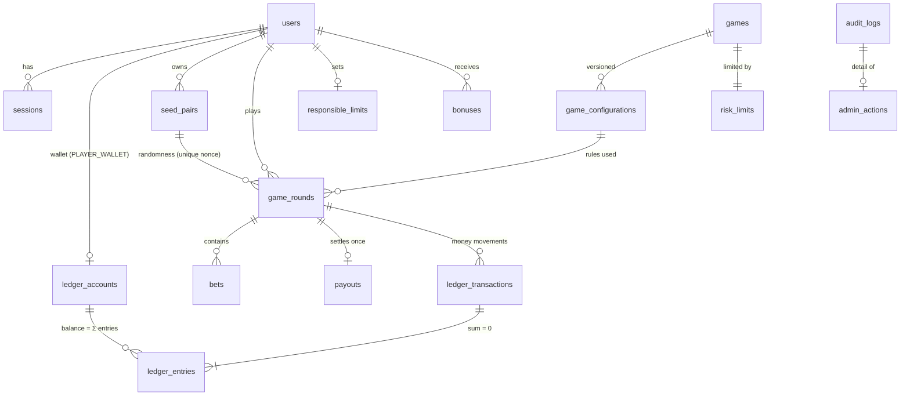

# Database design

PostgreSQL 16. Schema source of truth: [`migrations/`](../migrations) (forward-only,
checksum-tracked by `src/server/db/migrator.ts`). `src/server/db/schema.ts` mirrors it for
Drizzle; `tests/integration/schema-and-reconciliation.test.ts` fails on drift.

All money columns are `bigint` **minor units** (1 chip = 100). Theoretical statistics
(`expected_payout`, `payout_variance`) are `double precision` because they are estimates,
never balances.

## Entities

| Table | Purpose | Key constraints / indexes |
|---|---|---|
| `users` | Accounts, role, status, lockout, preferences | unique `email` (lower-case CHECK), unique `lower(username)`; deleted ⇒ no password hash |
| `sessions` | Opaque sessions (SHA-256 of token only) | unique `token_hash`; idle + absolute expiry |
| `password_reset_tokens` | Single-use, hashed, 30-minute tokens | unique `token_hash` |
| `games` | Game catalogue and status (`ACTIVE`/`SUSPENDED`/`DISABLED`) | |
| `game_configurations` | Immutable rule versions; one active per game | unique `(game_id, version)`; partial unique active; trigger blocks edits/deletes |
| `risk_limits` | Per-game stake, payout and exposure limits | `max_stake ≥ min_stake > 0` |
| `platform_settings` | Singleton: kill switch, total exposure, reserve floor, balance cap, bonuses, anomaly threshold | `id = 1` |
| `ledger_accounts` | Wallets and system accounts | non-negative unless `allow_negative`; wallet ⇔ `user_id`; trigger: balance changes only via entries, identity immutable |
| `ledger_transactions` | Transaction header; `idempotency_key` = business key (`round:<id>:settle`) | unique key; append-only |
| `ledger_entries` | Signed amounts; `balance_after`; gapless `account_seq` | append-only; unique `(account_id, account_seq)`; deferred trigger: Σ = 0 and ≥ 2 entries |
| `seed_pairs` | Provably fair seeds (server seed AES-GCM encrypted), next nonce | one ACTIVE per user; revealed pairs immutable; nonce never decreases |
| `game_rounds` | One row per round; risk snapshot; state JSON | unique `(seed_pair_id, nonce)`; one OPEN round per (user, game); settled/voided rows immutable; status/settled/payout consistency CHECKs; `expires_at` only on OPEN rows (partial index `game_rounds_expiry_due_idx` for the expiry queue, migration 0003) |
| `bets` | Every accepted wager (one per roulette position, double, split…) | unique `(round_id, seq)`; append-only |
| `payouts` | Exactly one per settled round (amount may be 0) | unique `round_id`, unique ledger tx; append-only |
| `bonuses` | Virtual rewards with unique claim keys (`daily:<user>:<date>`) | unique `claim_key`; append-only |
| `responsible_limits` | Player limits, pending increases, breaks, self-exclusion | range CHECKs |
| `idempotency_keys` | Request replay store (response saved in the same transaction) | PK `(user_id, key)` |
| `rate_limit_buckets` | Fixed-window counters shared by all instances | PK `(key, window_start)` |
| `audit_logs` | Security and business events | append-only, no TRUNCATE |
| `admin_actions` | State-changing staff actions with reason, before/after | reason ≥ 5 chars; append-only |
| `reconciliation_runs`, `alerts`, `error_events` | Operations | alert `dedupe_key` unique |
| `user_favorites` (0005) | A player's favourite games | PK `(user_id, game_id)`; the runtime role may delete its rows |
| `user_achievements` (0005) | Cosmetic badges with the fact that earned them | PK `(user_id, achievement_id)`; append-only; no balance or value |
| `users.display_name`, `users.avatar` (0005) | Optional profile fields | shape CHECKs (2–32 trimmed printable characters; preset id) |
| `sports_competitions`, `sports_teams` (0006) | Catalogue rows, demo or provider-namespaced ids | `is_demo` flag |
| `sports_events` (0006) | Fixtures, status, score, result version; demo seed hash/encrypted seed/model | unique `(source, external_id)`; demo ⇒ commitment and model present |
| `sports_external_refs` (0006) | Odds-provider event id → event | PK `(provider, external_id)` |
| `sports_markets`, `sports_selections` (0006) | 1X2 market (status, odds source, `odds_updated_at`, version) and prices | odds 1.01–1000 or NULL (not offered) |
| `sports_odds_history` (0006) | Every price change | append-only |
| `sports_tickets` (0006) | One prediction: odds snapshot, stake, potential return, status, credited payout, settlement source/version, idempotency key | unique `(user_id, idempotency_key, leg)`; rejected ⇔ reason; open/rejected ⇔ no payout; payout ≤ potential return |
| `sports_result_log`, `sports_settlements` (0006) | Result versions; per-ticket settlement per version (outcome, entitlement, credited, ledger tx) | append-only; unique `(event_id, version)` / `(ticket_id, version)` |
| `user_sports_favorites`, `sports_provider_status` (0006) | Followed teams/competitions; provider health | — |
| `user_role` += `OWNER`, `ledger_tx_type` += `CHIP_GRANT` (0007) | Owner role; owner-granted virtual test chips | enum values only (used from 0008 on) |
| `audit_logs.actor_role`, `audit_logs.outcome` (0008) | Role held when acting; `SUCCESS` / `DENIED` / `FAILED` | CHECKs; existing rows `SUCCESS`, role NULL; table stays append-only |
| `users_keep_an_owner` trigger (0008) | The last active owner cannot be demoted, suspended or deleted | BEFORE UPDATE OF role, status |
| `user_mfa` (0008) | TOTP secret (encrypted), enabled time, last accepted step, hashed recovery codes | one row per user; last_step ≥ 0 |
| `sessions.mfa_verified_at`, `platform_settings.staff_mfa_required` (0008) | Session passed the second factor; owner policy | — |
| `sports_markets.opens_at`, `closes_at` (0008) | Optional prediction window | close > open; close never later than kick-off (application) |
| Indexes (0008) | users by created/status, rounds by start, live sessions by last seen, tickets by placement, ledger by type and time, audit by time and non-success outcome | back-office filters and period queries |

## Ledger design (double entry)

Accounts: `PLAYER_WALLET` (one per user), `HOUSE_BANKROLL`, `WAGERS_IN_PLAY` (escrow),
`PROMOTIONS`, `ADJUSTMENTS`, `ISSUANCE`. A positive amount increases the balance; every
transaction sums to zero, so the sum of all balances is always zero (closed system).
`ISSUANCE` is negative by the total virtual currency ever created.

| Transaction | Entries |
|---|---|
| `BET_PLACED` | wallet −stake · escrow +stake |
| `BET_SETTLED` | escrow −stake · house +stake · house −payout · wallet +payout |
| `ROUND_VOIDED` | escrow −stake · wallet +stake |
| `BONUS_GRANTED` | promotions −amount · wallet +amount |
| `ADJUSTMENT` | adjustments ∓amount · wallet ±amount (references the corrected transaction) |
| `HOUSE_FUNDING` | issuance −amount · house +amount |

## Invariants and where they are enforced

| # | Invariant | Database | Application | Verified by |
|---|---|---|---|---|
| 1 | Balance changes only server-side | balance trigger | no client amounts accepted | API tests |
| 2 | Each accepted bet recorded once | `bets (round_id, seq)` unique | `round:<id>:bet:<seq>` ledger key | integration |
| 3 | Each payout recorded once | `payouts.round_id` unique, settle key unique | — | reconciliation |
| 4 | Financial changes atomic | single transaction | `withTransaction` | fault-injection tests |
| 5 | Duplicate requests don't duplicate effects | `idempotency_keys` PK | replay stored response | concurrency tests |
| 6 | No invalid balance under concurrency | non-negative CHECK | wallet `FOR UPDATE` | parallel-wager tests |
| 7 | Integer minor units | `bigint` | `Number.isSafeInteger` guards, BigInt maths | unit tests |
| 8 | Reject invalid / unauthorised transactions | CHECKs, FKs | Zod, RBAC, risk engine | API/e2e tests |
| 9 | History never silently modified | append-only triggers | no update paths | tamper test |
| 10 | Corrections via compensating entries | — | `ADJUSTMENT` only | admin tests |
| 11 | Settled rounds reconcile | — | — | 22 reconciliation checks (below) |
| 12 | No partial settlement | deferred balance check, one transaction | — | fault-injection tests |

## Reconciliation checks

`src/server/jobs/reconciliation.ts` re-derives every invariant from raw rows in one
`REPEATABLE READ READ ONLY` snapshot; it never trusts the application's summaries.
Missing records are found with outer joins (a missing transaction or payout row is a
mismatch, not a silently dropped join row). Postings are classified per round or
transaction against the *owner* (the round's / transaction's player), so money that is
balanced but sent to the wrong account is still caught. Any mismatch marks the run
`MISMATCH` and raises a CRITICAL alert. Fault-injection coverage:
`tests/integration/reconciliation-faults.test.ts` (savepoint-scoped, rolled back).

| Check | Verifies |
|---|---|
| `transactions_balanced` | every transaction sums to 0 with ≥ 2 entries |
| `account_balances_match_entries` | each account balance = Σ its entries |
| `balance_after_chain` | each entry's `balance_after` = running sum in `account_seq` order |
| `account_sequence_gapless` | per-account sequence 1..n matches the entry counter |
| `system_closed` | Σ all balances = 0 |
| `no_negative_restricted_accounts` | wallets, house and escrow ≥ 0 |
| `escrow_matches_open_rounds` | wagers-in-play = Σ stake of OPEN rounds |
| `round_stakes_match_bets` | stake = Σ bets (all the owner's) = BET_PLACED postings: owner wallet −stake, escrow +stake, no house or other legs |
| `settled_rounds_have_one_payout` | exactly one BET_SETTLED for the owner: wallet +payout, escrow −stake, house +(stake − payout), no other legs; exactly one payout row (amount, owner, linked transaction) |
| `unsettled_rounds_have_no_payout` | OPEN/VOIDED rounds have no payout value, payout row or settlement |
| `voided_rounds_refunded_exactly` | exactly one ROUND_VOIDED for the owner: wallet +stake, escrow −stake, nothing else; no refund on any non-voided round |
| `round_transactions_linked` | wager/settlement/refund transactions reference an existing round of the same player with a compatible status; other types reference no round |
| `payouts_within_declared_max` | payout ≤ the max payout approved by the risk engine |
| `nonces_unique_and_below_counter` | nonces are below the seed pair counter (no reuse) |
| `bonuses_match_ledger` | bonus rows ↔ BONUS_GRANTED transactions one-to-one: owner wallet +amount, promotions −amount, nothing else |
| `admin_money_movements_audited` | every ADJUSTMENT (owner wallet vs adjustments account), every CHIP_GRANT (owner wallet +x vs promotions −x, nothing else) and every non-bootstrap HOUSE_FUNDING has an actor and exactly one matching audited admin action with the same amount |
| `expiry_queue_not_overdue` | no OPEN round is > 5 min past its `expires_at` (expiry job health) |

**Limitation:** a PostgreSQL superuser or table owner can disable triggers. In production,
run the application with a role that owns nothing (`GRANT SELECT, INSERT` on append-only
tables, `UPDATE` only where needed) and keep migrations under a separate owner role; the
reconciliation job independently detects tampering (tested by disabling a trigger and
editing an entry).
